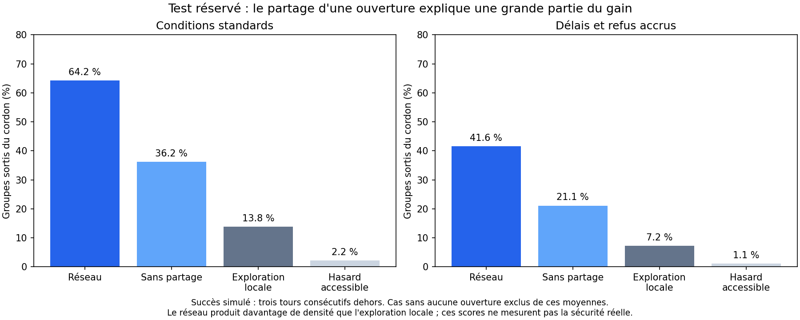

# nasse-sim

[](https://github.com/Nctrn17/nasse-sim/actions/workflows/tests.yml)

**Un laboratoire ouvert pour étudier, par simulation, des sorties non violentes d'un encerclement de foule.** Le but est de confronter des comportements appris à des règles simples, expliciter les hypothèses et améliorer collectivement le modèle.

La v2 commence avec tous les groupes enfermés. Les passages éventuels ne sont pas signalés à l'avance. Les actions sont marcher, attendre, demander un passage et partager une ouverture observée. Un cordon fermé est infranchissable. Les rues viennent d'OpenStreetMap ; les réactions du cordon restent hypothétiques.

**Ce prototype ne fournit pas de tactique validée sur le terrain.** Plus de sorties dans le modèle ne signifie pas plus de sécurité : le réseau appris augmente aussi la densité près des passages. Sans ouverture, aucune sortie n'est possible dans cette simulation.

## Résultat de référence : v2

Trois entraînements indépendants, 115 200 épisodes au total ; sélection sur validation, puis 6 144 épisodes de test sur une autre graine. Les pourcentages ci-dessous excluent le contrôle sans ouverture.

| Comportement | Conditions standards | Délais et refus accrus |
|---|---:|---:|
| Réseau complet | 64,2 % | 41,6 % |
| Même réseau sans partage | 36,2 % | 21,1 % |
| Exploration locale avec mémoire | 13,8 % | 7,2 % |
| Déplacements accessibles aléatoires | 2,2 % | 1,1 % |

Le gain dépend largement du partage d'information, actuellement diffusé à tous les groupes. Il s'accompagne d'une hausse de l'indicateur de surdensité. La réussite signifie **trois tours consécutifs hors du cordon**, suivis du retrait du groupe. Ni cette durée ni cet indicateur de densité ne sont validés physiquement.



[Résultats et limites](docs/RESULTATS_V2.md) · [Modèle](docs/MODELE.md) · [Reproduction](docs/REPRODUIRE.md) · [Feuille de route](docs/ROADMAP.md)

## Démarrer sur CPU

Python 3.11 est la version de référence. Aucun compte cloud ni GPU n'est requis pour les tests et les petits essais.

```bash
git clone https://github.com/Nctrn17/nasse-sim.git
cd nasse-sim
python -m venv .venv
```

Activer l'environnement : `source .venv/bin/activate` sur Linux/macOS, ou `.venv\Scripts\Activate.ps1` dans PowerShell.

```bash
python -m pip install --upgrade pip
python -m pip install -r requirements.txt
python -m unittest discover -v
python train_exit.py --v2 --iters 2 --B 2 --threads 2 --out runs/smoke
python evaluate_exit.py --ckpt runs/smoke/ckpt_last.pt --B 2 --policies ia random --out results/smoke.json
```

Deux itérations vérifient le fonctionnement ; elles ne produisent pas un modèle exploitable. PyTorch utilise CUDA si disponible. Pour une installation CPU ou CUDA spécifique, suivre les [instructions officielles PyTorch](https://pytorch.org/get-started/locally/).

## Reprendre les modèles publiés

La [release v0.2.0](https://github.com/Nctrn17/nasse-sim/releases/tag/v0.2.0) contient les trois checkpoints v2, les journaux, les résultats détaillés et les replays. Les poids et archives ne sont pas stockés dans l'historique Git.

```bash
python scripts/download_artifacts.py
python report_exit_v2.py --input artifacts/v2/campaign/evaluation_v2.json
python analyze_exit_v2_results.py
```

Le téléchargement vérifie l'empreinte SHA256 publiée dans le dépôt avant extraction. Le chargement des checkpoints par les évaluateurs utilise `weights_only=True`.

Le programme d'entraînement v2 repart actuellement de poids neufs : il ne fournit pas encore de reprise exacte d'un entraînement interrompu. Les checkpoints permettent l'évaluation et contiennent l'optimiseur, mais pas tous les états aléatoires nécessaires à une reprise exacte.

## Participer

Nous avons besoin de contributions en simulation de foule, apprentissage par renforcement, validation empirique, visualisation, documentation et accessibilité. Une contribution utile peut être un scénario d'échec ou une critique sourcée, pas seulement du code.

- [Contribuer](CONTRIBUTING.md) : installation, tests, protocole de comparaison et pull requests.
- [Issues](https://github.com/Nctrn17/nasse-sim/issues) : bugs et travaux identifiés.
- [Discussions](https://github.com/Nctrn17/nasse-sim/discussions) : hypothèses, méthodes et coordination.
- [Priorités](docs/ROADMAP.md) : communication locale, compromis sorties/densité, observations documentées, reproductibilité.

Ne publiez pas de données permettant d'identifier des manifestants, de secrets d'accès ou de positions opérationnelles en temps réel. Pour une vulnérabilité, voir [SECURITY.md](SECURITY.md).

## Organisation et licences

`exit_env.py` porte le modèle v2, `train_exit.py` l'apprentissage, `evaluate_exit_v2.py` la sélection et le test. `env.py`, `train.py` et `police_script.py` fournissent aussi des briques historiques nécessaires aux imports ; leur ancien objectif d'évitement ne doit pas être confondu avec la sortie de cordon v2.

Code et documentation du projet : [licence MIT](LICENSE). Données cartographiques : **© les contributeurs OpenStreetMap, ODbL 1.0**, avec [provenance et périmètre](data/README.md). La licence du code ne remplace pas celle des données. Les fichiers publiés ne contiennent que les rues utilisées par le simulateur, aucune couche de caméras.

**English:** an open research simulator for nonviolent crowd egress from containment. Experimental assumptions, reproducible baselines and failure cases are central; the results are not validated real-world safety advice. Contributions in French or English are welcome.
