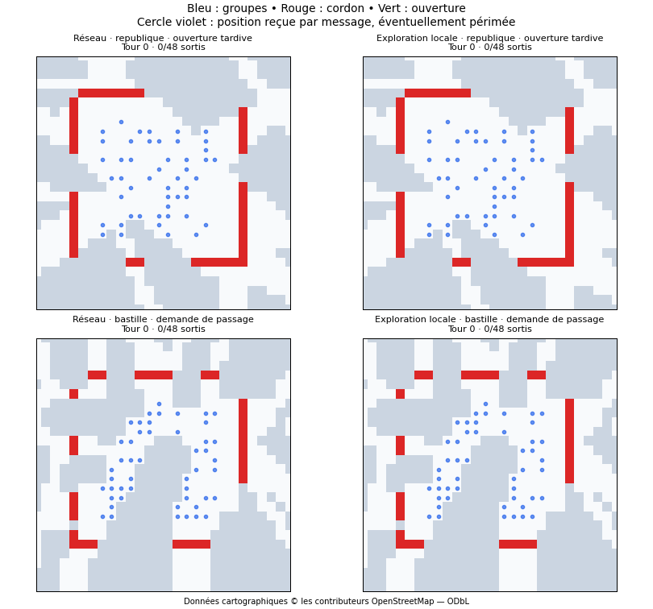

# Résultats v2 et limites

Campagne du 23 octobre 2026. Les données détaillées et checkpoints sont dans la release `v0.2.0`.

| Comportement | Standards | Conditions difficiles |
|---|---:|---:|
| Réseau complet | 64,2 % | 41,6 % |
| Sans partage | 36,2 % | 21,1 % |
| Exploration locale avec mémoire | 13,8 % | 7,2 % |
| Hasard parmi les déplacements accessibles | 2,2 % | 1,1 % |

Ces moyennes excluent `sealed`, qui donne toujours zéro sortie. Trois entraînements de 600 lots de 64 épisodes, soit 115 200 épisodes. La validation comprend 864 épisodes ; le test en comprend 6 144. Le réseau de graine 0 est sélectionné sur la pire combinaison lieu/orientation de validation, avant tout test.

Les moyennes de validation des trois réseaux sont 66,1 %, 65,0 % et 63,7 %. Seul le réseau retenu subit le test complet : ce ne sont pas trois répétitions du résultat final.

## Ce qui explique le gain

Retirer le partage au réseau déjà entraîné réduit les sorties de 28 points en conditions standards et de 20,5 points dans le profil difficile. Dans les 24 replays du réseau, les messages ont été reconstruits et les positions/ouvertures vérifiées à chaque étape. Lorsqu'un message encore valide existe, 73,8 % des mouvements réduisent la distance de Manhattan au passage signalé.

Cela étaye un comportement de convergence vers une ouverture communiquée. Cela ne prouve pas une coordination humaine sophistiquée : seuls 163 actes de partage sur 16 237 dans ces replays sont émis avec une ouverture visible. Quelques messages utiles ont beaucoup d'effet parce que leur diffusion est globale.

## Le compromis non résolu

Le proxy cumulé de surdensité vaut **3,08 pour le réseau contre 0,26 pour l'exploration locale** en conditions standards, et **3,05 contre 0,31** dans le profil difficile. Plus de sorties ne signifie donc pas une stratégie globalement plus sûre. Ces nombres ne sont pas des taux de blessures.

## Sensibilité aux hypothèses

| Scénario | Standards | Difficiles |
|---|---:|---:|
| Ouverture tardive permanente | 96,0 % | 80,0 % |
| Ouverture après demande | 48,9 % | 11,2 % |
| Ouvertures temporaires | 47,6 % | 33,6 % |
| Aucune ouverture | 0 % | 0 % |

Les résultats dépendent fortement de ce qui est supposé possible. Aucune calibration récente du comportement policier réel n'est revendiquée.

Le biais de direction de la v1 n'apparaît plus dans ces tests : le score standard varie selon l'orientation de 68,2 à 69,1 % à République, de 60,6 à 62,8 % à Bastille et de 60,4 à 62,5 % à Nation. Les données d'entraînement excluent les centres à moins de 1 km des lieux de test ; cela reste une évaluation dans une seule ville.

## Incertitude et illustrations

Un bootstrap apparié des différences donne [25,5 ; 30,6] points pour l'apport du partage en standard, [19,0 ; 21,9] en difficile. Il agrège les conditions pour chacun des 16 indices d'épisode ; il ne traite pas les groupes comme indépendants. Ce calcul conditionnel ne mesure ni l'incertitude du modèle policier ni toute la variation entre entraînements.

Deux exemples explicitement choisis : République avec ouverture tardive et Bastille avec réponse à une demande, réseau contre exploration locale. Ils illustrent le mécanisme ; ils ne représentent pas à eux seuls la distribution des résultats. Fond cartographique © les contributeurs OpenStreetMap, ODbL.
